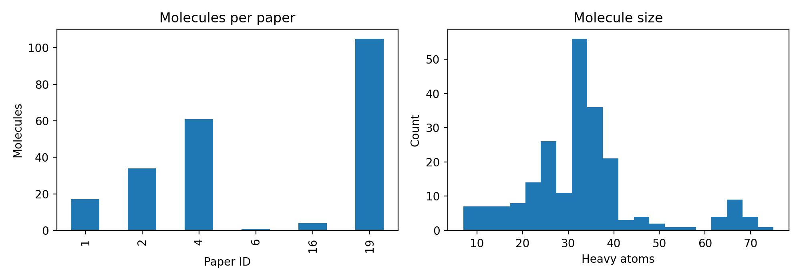

# Benchmarking BioMiner for SMILES Extraction from Scientific Papers

**Jasfer David Gabriel** | October 18, 2026 | Assignment 1.3: Individual Benchmark Report

## Introduction

Most chemical structures in scientific papers exist only as images, which means the information cannot be searched or reused by software. Converting these drawings into SMILES strings makes them machine readable, so they can be stored in databases, compared, and used to train machine learning models.

This conversion is still difficult. The ChemX benchmark (Vepreva et al., 2025) found that general LLMs and agent systems almost never extracted SMILES correctly, largely because they lack dedicated tools for turning molecule images into SMILES. Specialized systems therefore need independent testing on real papers.

In this report, I evaluate BioMiner (Yan et al., 2025), which combines multimodal LLMs, specialized vision models, and chemistry tools to extract molecules from papers. My dataset contains 222 molecules from 6 papers. I built and validated a reproducible benchmarking pipeline, but BioMiner inference could not be run because it requires NVIDIA GPU resources that were not available. This report therefore focuses on dataset analysis, metric validation, and published performance results to set expectations for the full benchmark.

## Methods

**Pipeline.** The benchmark runs in four stages: load, predict, evaluate, and save. The loader reads the ground truth CSV (222 molecules with paper ID, name, and SMILES), drops rows without SMILES, and matches each paper ID to its PDF. The prediction stage runs BioMiner on each PDF and caches its output so completed papers are not rerun. All code, configuration, and run instructions are available on GitHub (github.com/jasferdavidgabriel/biominer_ocsr_benchmark).

**Preprocessing.** Because the same molecule can be written as many different SMILES strings, both the ground truth and the predictions are canonicalized with RDKit before comparison. This ensures that equal molecules are always compared in the same form, regardless of which tool produced them.

**Matching.** BioMiner returns an unordered set of SMILES per paper, so predictions are compared only against molecules from the same paper. Each true molecule is matched to the prediction with the highest Tanimoto similarity (best match).

**Metrics.** I report four metrics. *Exact match recall* is the fraction of true molecules whose canonical SMILES appears among the paper's predictions. *Precision* is the fraction of predictions that exactly match a true molecule. *Mean best Tanimoto* averages the similarity between each true molecule and its closest prediction, using Morgan fingerprints (radius 2, 2048 bits); unlike exact match, it gives partial credit for near misses. *Valid prediction rate* is the fraction of predictions RDKit can parse as real molecules.

**Validation.** To verify the scoring code without BioMiner, I ran a sanity check that scores the ground truth against itself. All four metrics returned 1.0, as expected.

## Results

**Dataset characteristics.** Figure 1 and Table 1 summarize the ground truth. The dataset is highly imbalanced: paper 19 contributes 105 of 222 molecules (47%), while paper 6 contains a single molecule. Stereochemistry is rare overall (4.5% of molecules, detected by the stereo markers `@`, `/`, and `\` in SMILES) but concentrated in papers 16 (50%) and 1 (17.6%). Paper 6 contains the largest molecule (68 heavy atoms), roughly double the dataset median.

*Table 1. Ground truth composition by paper.*

| Paper ID | Molecules | Stereo (%) | Median heavy atoms |
|:--|--:|--:|--:|
| 1 | 17 | 17.6 | 35.0 |
| 2 | 34 | 0.0 | 25.0 |
| 4 | 61 | 6.6 | 35.0 |
| 6 | 1 | 0.0 | 68.0 |
| 16 | 4 | 50.0 | 34.5 |
| 19 | 105 | 1.0 | 34.0 |
| **Total** | **222** | **4.5** | |

*Table 2. Pipeline validation (ground truth scored against itself).*

| Metric | Expected | Observed |
|:--|--:|--:|
| Exact match recall | 1.0 | 1.0 |
| Precision | 1.0 | 1.0 |
| Mean best Tanimoto | 1.0 | 1.0 |
| Valid prediction rate | 1.0 | 1.0 |

*Table 3. Published OCSR results (not produced by this benchmark).*

| Tool | Setting | Score | Source |
|:--|:--|--:|:--|
| BioMiner (MolGlyph) | BioVista OCSR, all structures | 0.764 | Yan et al., BioMiner repository |
| BioMiner (MolGlyph) | BioVista OCSR, chiral structures | 0.504 | Yan et al., BioMiner repository |
| MolScribe | Synthetic images (Indigo) | 97.5% exact | Tang et al., 2026 |
| MolScribe | Real journal figures (ACS) | 71.9% exact | Tang et al., 2026 |

Real BioMiner predictions on this dataset are pending GPU access; Table 3 is provided as a reference for expected performance.

## Analysis and Interpretation

**Dataset imbalance.** Because paper 19 contributes 47% of all molecules, any overall metric will largely reflect BioMiner's performance on that single paper. To avoid this skew, results should be reported per paper and as an average across papers. Small papers create the opposite problem: paper 16 has four molecules, so a single error changes its recall by 25 points, and paper 6's result will be a single correct or incorrect prediction.

**Stereochemistry as the expected weak point.** BioMiner's published chiral accuracy (0.504) is far below its overall OCSR score (0.764). I therefore expect lower exact match recall on papers 16 and 1, which contain the most stereochemistry. Because stereo is rare overall (4.5%), this weakness should have only a modest effect on the dataset level score, which is another reason per paper reporting matters.

**Exact match and Tanimoto will disagree in informative ways.** The Morgan fingerprints used here ignore stereochemistry by default. A prediction with the correct structure but a wrong stereo marker will therefore fail exact match while scoring a Tanimoto near 1.0. Comparing the two metrics per molecule can separate stereo errors from structural errors. This matches findings by Tang et al. (2026), who observed that graph level correctness can improve while exact SMILES match does not.

**Public benchmarks versus real papers.** MolScribe drops from 97.5% exact match on clean synthetic images to 71.9% on real journal figures (Tang et al., 2026). My dataset consists of real papers, so I expect BioMiner to score at or below its published 0.764. Blevins and Quigley (2025) add a further caution: strong benchmark scores can reflect dataset specific shortcuts rather than true capability, so results on six papers may not generalize to the wider literature.

## Limitations and Conclusion

**Limitations.** The most significant limitation is that BioMiner inference has not yet been run, because the system requires NVIDIA GPUs that were not available. As a result, this report contains no measured BioMiner performance, and all expectations rely on published results. Since the pipeline caches predictions per paper, BioMiner can be run on a GPU environment and its outputs scored without code changes.

Second, the dataset is small and imbalanced: six papers, with paper 19 contributing 47% of molecules. Conclusions about BioMiner's general performance would be weak even with real predictions. Adding more papers from varied sources would reduce the influence of any single paper.

Third, BioMiner's main output lists molecules alongside bioactivity values, so molecules without reported bioactivity may be missing from its predictions. This could lower recall in a way that reflects the output format rather than recognition errors; extracting BioMiner's intermediate structure outputs would address this. Finally, stereochemistry was detected by searching for SMILES stereo markers, which is a fast approximation; RDKit's stereocenter detection would be more precise.

**Conclusion and implications for Phase 2.** This work produced a validated, reproducible benchmarking pipeline and a characterization of the dataset that sets clear expectations: likely weaker results on stereo heavy papers, informative disagreement between exact match and Tanimoto, and scores at or below published benchmarks. For Phase 2, three lessons stand out: secure GPU access before building the pipeline, report per paper results alongside overall scores, and track both exact match and Tanimoto so different error types can be distinguished.

## References

Blevins, A. D., and Quigley, I. K. (2025). Clever Hans in Chemistry: Chemist Style Signals Confound Activity Prediction on Public Benchmarks. arXiv:2512.20924.

Tang, H., Dang, X., and Wang, J. (2026). Fine-tuning DeepSeek-OCR-2 for Molecular Structure Recognition. arXiv:2604.03476.

Vepreva, A., et al. (2025). Benchmarking Agentic Systems in Automated Scientific Information Extraction with ChemX. NeurIPS 2025 AI4Mat Workshop. arXiv:2510.00795.

Yan, J., et al. (2025). BioMiner: A Multi-modal System for Automated Mining of Protein-Ligand Bioactivity Data from Literature. bioRxiv. doi:10.1101/2025.04.22.648951.
